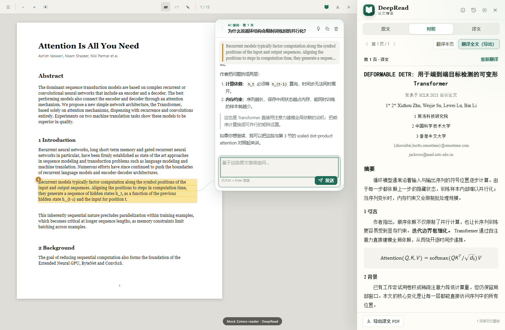
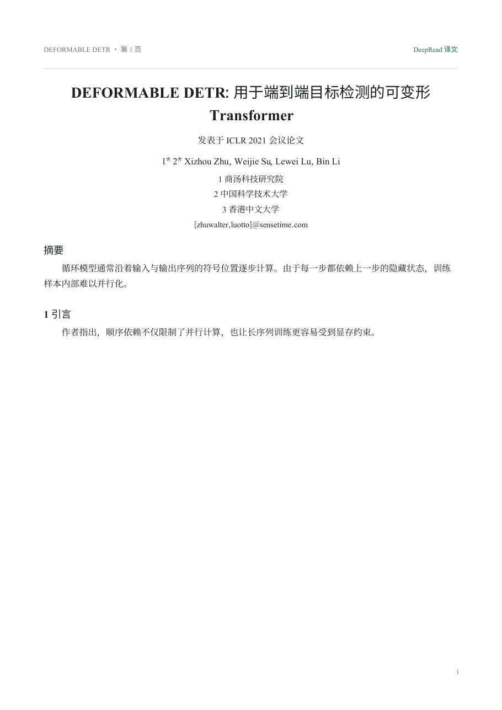

# ReadNow for Zotero

一个面向论文精读的 Zotero 7/10 插件：在 Zotero 阅读器里划词翻译、对照阅读原文与译文，并把每个 AI 提问锚定在原文选区上，支持围绕同一段内容继续追问。

项目主页：[chenxin1209/ReadNow](https://github.com/chenxin1209/ReadNow)

> 插件受 [zhikangSu/DeepRead](https://github.com/zhikangSu/DeepRead) 的产品思路启发；ReadNow 是独立的 Zotero 实现，不是 DeepRead 桌面版的官方插件。



> 上图是本地 mock 渲染的界面示意，实际界面以 Zotero 内为准。

## 功能

- **接入自己的 API Key**：支持 OpenAI 兼容接口、DeepSeek、Anthropic Claude、Google Gemini、OpenRouter、硅基流动、Ollama / 本地模型和自定义兼容接口。
- **原文 / 对照 / 译文三种模式**：在 Zotero 阅读器内切换；译文模式只显示当前页，翻页后自动切换并翻译对应页。
- **论文信息按钮**：在工作台顶部打开标题、作者、单位、年份和摘要，不再在每页翻译中重复注入这些信息。
- **LaTeX 公式渲染**：正文中 `$...$`、`$$...$$` 与 `\[...\]` 公式使用 KaTeX 显示。
- **轻量 Markdown 渲染**：译文中的 `**粗体**`、*斜体*、行内代码和 http(s) 链接会正常显示，不会露出 `**` 标记。
- **非正文标注**：图注、表注单独标记；Markdown 表格在阅读器中渲染为真实表格，在译文 PDF 中绘制为带边框的表格；图片区域会被截图插入译文页，图内文字不再送翻译；公式原样保留。
- **划词自动翻译**：选中文字后，Zotero 选区弹窗内直接显示译文；可关闭自动翻译，改为手动触发。
- **从选区发起 AI 提问**：选区弹窗中的「AI 提问」直接创建问答卡片。
- **可拖动、可缩放的提问卡片**：卡片会综合当前页文字、选区、页面留白和其他卡片位置，自动选择遮挡最少的位置。
- **每个提问绑定原文**：卡片保存选区文字、页码与 PDF 坐标；页面上用编号锚点和虚线连接卡片，点击锚点可回到原文。
- **围绕同一段内容追问**：同一张卡片内保留上下文和对话历史，适合逐句追问、解释术语、梳理论证。
- **译文 PDF 导出**：把已翻译页面重排成带中文字体的 A4 PDF，作为附件添加到论文条目并在 Zotero 中打开。
- **本机数据**：API Key 保存在 Zotero 本机配置；问答与翻译缓存保存在 Zotero 数据目录的 `deepread/` 下。

## 安装

1. 下载仓库根目录的 **`ReadNow-0.1.0.xpi`**。
2. 打开 Zotero → **工具 → 插件**。
3. 点击右上角齿轮 → **从文件安装插件…**，选择 `ReadNow-0.1.0.xpi`。
4. 安装后重启 Zotero（如果插件没有立即生效）。

要求：Zotero **7.9.9 或更高版本**。本版本已在 **Zotero 10.0.8 / Windows** 上做过端到端验证（阅读器、划词翻译、问答、偏好设置、译文 PDF 导出）。

## 配置

安装后有两种入口：

- Zotero → **工具 → ReadNow 设置…**
- Zotero → 编辑 → 设置 → **ReadNow** 面板

至少填写：

| 字段 | 说明 |
| --- | --- |
| 服务商 | 选择你的模型服务商，或「自定义 OpenAI 兼容接口」 |
| API Base URL | 例如 `https://api.openai.com/v1`、`https://api.deepseek.com`、`http://127.0.0.1:11434/v1` |
| API Key | 你自己的密钥；Ollama 本地通常留空 |
| 对话模型 | 用于 AI 问答；DeepSeek 官方当前为 `deepseek-flash` / `deepseek-v4-pro`，其他服务按文档填写 |
| 翻译模型 | 用于划词/整页翻译；可填更便宜的小模型 |

DeepSeek 当前官方模型为 **`deepseek-flash`**（默认）和 **`deepseek-v4-pro`**；旧模型名 `deepseek-v4-flash`、`deepseek-v4-flash-vision-exp` 仍可调用，但会由新版 Flash 模型提供服务。旧的 `deepseek-chat` 已不作为默认值。DeepSeek 默认开启思考模式，插件默认关闭思考模式以保证翻译速度；复杂问答可在设置中打开「DeepSeek 思考模式」。

填好后点 **测试连接**，再点 **保存设置**。

> API Key 会写入本机 Zotero 配置目录下的 `prefs.js`，不会同步到 Zotero 服务器，也不会发送给 ReadNow。仍建议不要在共享电脑上保存长期密钥。

## 使用

### 1. 打开工作台

在 Zotero 中打开一篇 PDF，点击阅读器工具栏右侧的 **ReadNow 书本图标**。

工作台提供三种模式：

- **原文**：保持 Zotero 原始阅读体验，问答卡片仍可浮在原文上。
- **对照**：左侧原文 PDF、右侧当前页译文，推荐精读时使用。
- **译文**：全宽显示已翻译的全文页面。

### 2. 划词翻译

选中文字后，选区弹窗会显示：

- 自动翻译结果（可在设置中关闭自动翻译）
- **AI 提问**：直接围绕这段文字创建卡片
- **对照阅读**：打开对照模式并定位到该页

### 3. AI 提问卡片

- 卡片标题、选区引文和 PDF 页码都会保留。
- 拖动顶部把手移动卡片；拖动右下角调整大小。
- 卡片会根据当前页文字、选区、页面留白与其他卡片自动选位。
- 输入问题后按 `Ctrl/⌘ + Enter` 或点发送；同一张卡片内可以继续追问。
- 点击卡片上的定位/引文区域，或页面上的编号锚点，可回到对应原文。
- 顶部可复制整段对话或删除卡片；底部有「问答记录」入口。

### 4. 翻译与导出

- 对照/译文模式会按需翻译当前页；「翻译全文」会逐页请求并缓存。
- 译文按论文排版显示：一级标题黑体小四、正文宋体五号且首行缩进 2 字符、注释/参考文献宋体小五；英文使用 Times New Roman。
- 首页的标题、作者、单位、邮箱和会议信息按封面信息居中排版，不会被误当成章节标题或正文。
- 翻译结果保存在 `deepread/cache.json`，下次打开同一篇论文会直接复用。
- 点击底部 **导出译文 PDF**：
  - 已翻译页面会重排为 A4 译文 PDF；
  - 自动添加为当前论文的子附件；
  - 在 Zotero 中打开该 PDF。

> 译文 PDF 是**重排后的文本版**，不是原版式的双语对照 PDF；公式、表格、双栏排版可能有损失。需要精确版式时请对照原文阅读。



## 数据与隐私

| 数据 | 位置 |
| --- | --- |
| API Key、模型、提示词等偏好 | Zotero 本机 `prefs.js`（`extensions.zotero.deepread.*`） |
| 问答卡片 | `<Zotero 数据目录>/deepread/chats.json` |
| 翻译缓存 | `<Zotero 数据目录>/deepread/cache.json` |
| 译文 PDF | 作为 Zotero 附件保存到论文条目下 |

- 插件**没有**自建服务器、遥测或账号体系。
- 翻译和问答请求由 Zotero 直接发送到你填写的 API 地址。
- 发送内容仅限当前请求需要的文本：选区、当前页/相邻页上下文、对话历史、论文标题/作者/摘要等元数据。
- 不阅读、不上传未参与请求的其他页面。

## 已知限制

- **扫描版 PDF** 没有文本层，无法提取原文进行翻译；需要先 OCR。
- 双栏 PDF 的文本提取按 PDF.js 文本层顺序进行，极少数复杂版式可能出现段落顺序不理想。
- 译文 PDF 为文本重排，不能保留原始图表位置与精确分页。
- 不同 OpenAI 兼容服务的字段支持略有差异；如遇 400/404，请检查 Base URL、模型名与接口兼容性。
- 问答卡片是插件本地数据，不是 Zotero 原生批注，也不会随 Zotero 同步到其他设备。
- 本版本没有 PDF 译文与原 PDF 的逐段对齐高亮，只提供同页对照。

## 开发

```bash
# Node.js 20+（开发时使用 Node 24）
pnpm install
pnpm test
pnpm build
```

构建产物：

- `ReadNow-0.1.0.xpi` — 可安装插件
- `dist/` — 解包后的插件目录（便于检查）
- `demo/mock.html` — 不启动 Zotero 时的 UI mock（需要先 `pnpm build`）

### 目录结构

```
bootstrap.js                 Zotero 启动/关闭入口，注册 chrome 包
manifest.json                Zotero 7+ 插件清单
prefs.js                     默认偏好
src/
  index.js                   插件主类、模型请求、偏好面板注册
  llm.js                     OpenAI / Anthropic / Gemini 请求与 SSE 解析
  translation.js             翻译/问答提示词、分块、缓存键
  storage.js                 问答与翻译缓存（JSON 文件）
  layout.js                  卡片留白选位、PDF 坐标映射
  markdown.js                安全的轻量 Markdown 渲染
  pdf-export.js              译文 PDF 排版（pdf-lib + 中文字体）
  reader/
    integration.js           Zotero.Reader 事件注册
    workspace.js             原文/对照/译文工作台
    card.js                  可拖动/缩放/追问的问答卡片
    selection-popup.js       划词弹窗
    pdf-access.js            PDF.js 文本、页面坐标、元数据
  preferences-pane.js        偏好设置面板逻辑
static/
  preferences.xhtml/.css/.js 偏好设置面板
  assets/NotoSansSC-Regular.ttf  内置中文字体（OFL）
  icons/                     插件图标
test/                        单元测试
```

### 测试

```bash
pnpm test
```

单元测试覆盖：卡片留白评分、PDF 坐标映射、三类模型请求与 SSE、翻译提示词、分块、缓存、Markdown 安全渲染、JSON 存储、中文 PDF 生成。

## 致谢

- [Zotero](https://www.zotero.org/) 与 Zotero Reader
- [DeepRead](https://github.com/zhikangSu/DeepRead) — 产品交互参考
- [pdf-lib](https://pdf-lib.js.org/) 与 [@pdf-lib/fontkit](https://github.com/Hopding/fontkit)
- [KaTeX](https://katex.org/) — MIT，公式字体遵循各自的 SIL Open Font License
- [Noto Sans SC / Noto Serif SC](https://github.com/notofonts/noto-cjk) — SIL Open Font License 1.1

## License

代码以 MIT License 发布，见 [LICENSE](LICENSE)。内置 Noto Sans SC / Noto Serif SC 字体遵循 SIL Open Font License 1.1，见 [static/assets/LICENSE-NotoSansSC.txt](static/assets/LICENSE-NotoSansSC.txt)。
